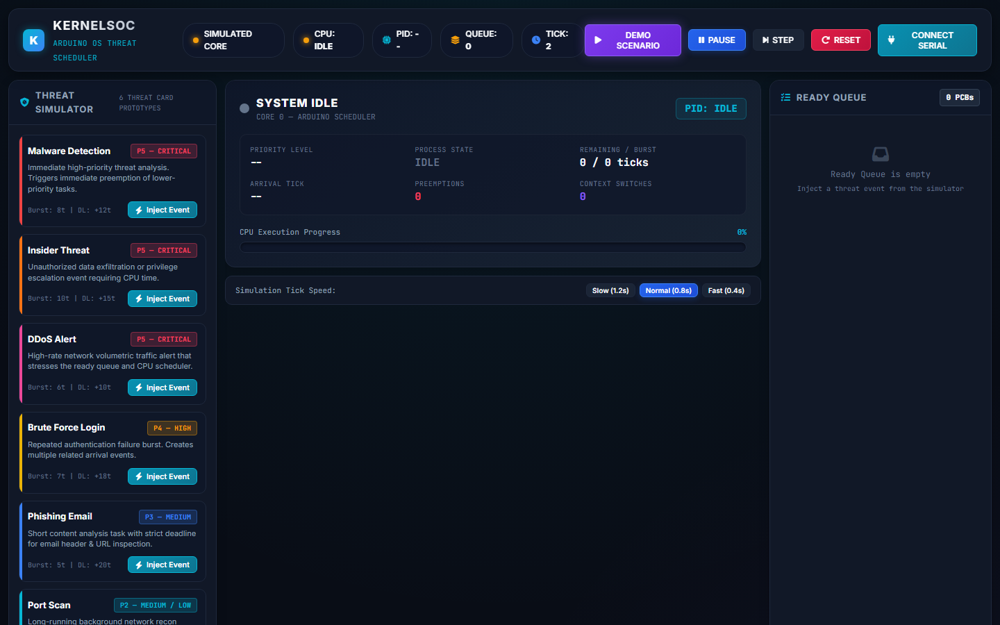
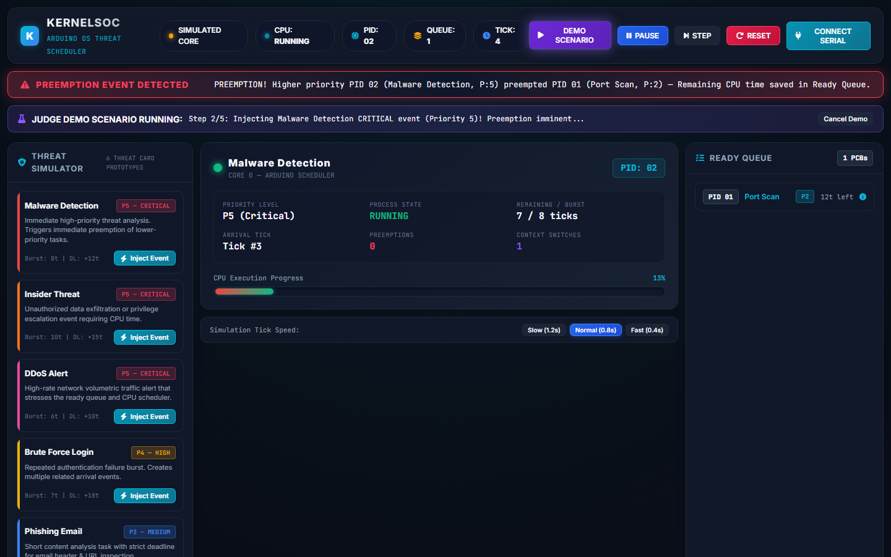

# KernelSOC — Security Operations Center Web Dashboard

**KernelSOC** is a judge-facing Security Operations Center (SOC) web application built to visualize the Operating System (OS) kernel behavior of an Arduino/ESP32 security prototype.

It visualizes key OS kernel concepts in real time:
- **Process Control Blocks (PCB)**
- **Preemptive Priority Scheduling**
- **Ready Queue State Transitions**
- **Context Switching & Interrupt Handling**
- **CPU Execution & Timer Ticks**
- **Threat Event Logging & CPU Timeline Gantt Chart**

---

## 🖼 Screenshots

### 1. Main SOC Dashboard Overview


### 2. Live Preemption Demo Scenario


---

## 🚀 Features & Architecture

- **6 Threat Process Prototypes**:
  1. **Malware Detection** (Critical - P5, Burst: 8t)
  2. **Insider Threat** (Critical - P5, Burst: 10t)
  3. **DDoS Alert** (Critical - P5, Burst: 6t)
  4. **Brute Force Login** (High - P4, Burst: 7t)
  5. **Phishing Email** (Medium - P3, Burst: 5t)
  6. **Port Scan** (Medium/Low - P2, Burst: 15t)

- **Judge Demo Scenario Runner**:
  Clicking **DEMO SCENARIO** in the top navigation bar executes the official project demonstration:
  1. Spawns long-running **Port Scan** process into `RUNNING` state.
  2. Injects a high-priority **Malware Detection** threat.
  3. Demonstrates immediate **Preemption**: Port Scan is moved to `PREEMPTED` -> `READY` queue with its remaining CPU burst time saved.
  4. Dispatches **Malware Detection** to CPU.
  5. After Malware Detection completes, **Port Scan** is restored to `RUNNING` with saved state.

- **Web Serial API Driver (`serial.js`)**:
  Connects directly to Arduino/ESP32 hardware over USB serial (9600 baud). Receives live event JSON protocol streams and sends injection/pause/reset commands. Falls back gracefully to Simulated Core mode when running offline.

- **Interactive PCB Inspector**:
  Clicking any PCB card in the Ready Queue or the CPU Core card opens the PCB Inspector Modal, displaying full runtime metrics and exact raw JSON data structure.

- **Real-Time CPU Timeline**:
  Visualizes execution history per PID with preemption markers (⚡) and context switch intervals.

---

## 🛠 Project Structure

```
kernalSOC/
├── index.html            # SOC Console HTML structure & modals
├── style.css             # Modern dark cyber theme & responsive layouts
├── app.js                # UI controller, event bindings & demo scenario runner
├── serial.js             # WebSerial driver & hardware JSON protocol handler
├── scheduler.js          # Preemptive Priority OS Scheduler core
├── data.js               # PCB class & threat process definitions
├── docs/
│   └── screenshots/      # Application screenshots for README
│       ├── dashboard_overview.png
│       └── preemption_demo.png
└── README.md             # Documentation & user manual
```

---

## 🏁 How to Run

1. Open `index.html` directly in any modern WebSerial-compatible Chromium browser (Google Chrome, Microsoft Edge, Opera, Brave).
2. Alternatively, run a local web server:
   ```bash
   python -m http.server 8000
   ```
   and navigate to `http://localhost:8000`.

---

## 📡 Hardware Protocol

Arduino/ESP32 communicate with the Web App over Serial using JSON events:

```json
{"type":"event","pid":7,"attack":"Malware Detection","priority":5,"state":"READY"}
{"type":"switch","fromPid":4,"toPid":7,"reason":"higher_priority"}
{"type":"tick","pid":7,"remainingTime":8}
{"type":"complete","pid":7}
```

Web App dispatches commands to the microcontroller:

```json
{"cmd":"inject","attack":"DDoS Alert"}
{"cmd":"pause"}
{"cmd":"resume"}
{"cmd":"reset"}
```

---

## 📋 Acceptance Checklist Verification

- [x] **6 Threat Attacks Visible**: Malware Detection, Brute Force Login, Phishing Email, Port Scan, Insider Threat, DDoS Alert.
- [x] **Event Injection**: Clicking "Inject Event" triggers arrival, PCB creation, and queue insert.
- [x] **Live CPU State Card**: Real-time display of active PID, priority, remaining time progress bar, preemptions, and context switches.
- [x] **Ready Queue**: Sorted dynamically by priority (P5 -> P1) with tie-breaker logic.
- [x] **PCB Inspector**: Detailed modal inspector showing PCB fields and raw JSON struct.
- [x] **Preemption Header Notification**: High-visibility animated banner when preemption occurs.
- [x] **Context Switching**: Logged with `fromPid` -> `toPid` state updates.
- [x] **Timer Ticks**: Real-time tick counter with adjustable simulation speed (0.4s / 0.8s / 1.2s).
- [x] **Event Protocol Log**: Filterable & exportable JSON terminal log of all OS transitions.
- [x] **CPU Execution Timeline**: Horizontal Gantt chart track with preemption indicators.
- [x] **Reset / Pause / Step Controls**: Full interactive control of simulation clock.
- [x] **Port Scan → Malware Preemption Demo**: One-click judge scenario runner.
